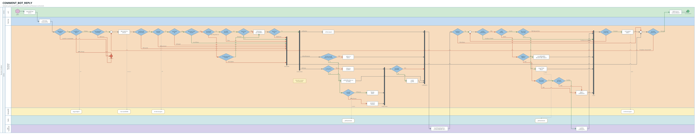

# E2E Flow — COMMENT_BOT_REPLY

Generated from `swimlane.flow` — edit it, then re-run swimlane.py.

ลูปซ้อนกันสองชั้น — ลูปนอกวนบอทของร้านทีละตัว (`m_bot` … `d_bot`) ·
ลูปในวนตรวจผลของแต่ละคำสั่งที่ส่งไป Facebook (`m_in` … `d_more`)

## Business conditions

### ก่อนเข้าบอท
| # | question in the diagram | box | from |
|---|---|---|---|
| 1 | เป็นคอมเมนต์จริงไหม | `d_real` | `validateForComment` — ตัด reaction, ไม่มี comment_id, verb edited |
| 2 | เพจเปิดใช้งานอยู่ไหม | `d_page` | `getByRefIdAndActive` คืน null |
| 3 | คนคอมเมนต์เป็นลูกค้าใช่ไหม | `d_who` | `from.id !== socialNetwork.refId` กันบอทตอบตัวเอง |

### ด่านของบอทแต่ละตัว (อยู่ในลูปนอก)
| # | question in the diagram | box | from |
|---|---|---|---|
| 4 | บอทเป็นของทีมเดียวกับเพจไหม | `d_team` | `socialNetwork.teamId !== bot.teamId` |
| 5 | ตอบคนเดิมซ้ำได้ไหม | `d_again` | `bot.repeat === false` + `LogReplyOnce` |
| 6 | ดูแลโพสต์นี้ไหม | `d_post` | `bot.type === 'SOME_POST'` + `checkMatchingPostId` |
| 7 | มีบอทเฉพาะโพสต์คุมอยู่ไหม | `d_spec` | `isNoReplyRepeatSomePost` |
| 8 | คอมเมนต์เป็นข้อความไหม | `d_text` | `findCommentType` แยก MESSAGE ออกจาก IMAGE/STICKER |
| 9 | ตรงคำที่ตั้งให้ตอบไหม | `d_kw` | `replyKeywords.some(...)` |
| 10 | มีคำต้องห้ามไหม | `d_ban` | `noReplyKeywords.some(...)` |
| 11 | บอทตั้งรับคอมเมนต์แบบนี้ไหม | `d_type` | `bot.reply.includes(commentType)` — เส้นของรูป/สติกเกอร์ ไม่เช็คคำเลย |
| 12 | มีคำสั่งจะส่งไหม | `d_has` | `batchPayload.length === 0` |

### ตอนประกอบคำตอบ
| # | question in the diagram | box | from |
|---|---|---|---|
| 13 | ตอบใต้คอมเมนต์มีทั้งข้อความและรูปไหม | `d_both` | `haveImage ? { name }` + `haveText ? { depends_on }` |
| 14 | แชทเป็นรูปไหม | `d_chatimg` | `responseItemMessage.type === 'TEXT'` |
| 15 | เคยส่งรูปนี้แล้วไหม | `d_cached` | `findImageAttachmentId` หาใน Redis |
| 16 | ต้องแนบปุ่มดูรูปเพิ่มไหม | `d_quick` | `messages.length > 1 && itemId && messageId` |

### ตอนอ่านผลจาก Facebook (อยู่ในลูปใน)
| # | question in the diagram | box | from |
|---|---|---|---|
| 17 | ยิงคำสั่งออกไปได้ไหม | `d_sent` | `if (!result) continue` |
| 18 | คำสั่งนี้รอคำสั่งอื่นอยู่ไหม | `d_wait` | `response === null && payload[index].name` |
| 19 | คำสั่งนี้สำเร็จไหม | `d_ok` | `response.code < 400` |
| 20 | ไลฟ์ยังไม่จบอยู่ใช่ไหม / รูปที่เคยส่งหมดอายุไหม | `d_live` · `d_exp` | `error.code === 1705` · `code 100 subcode 2018074` |

## Lane → what tests mock or seed
| lane | real system | unit | component | api-test |
|---|---|---|---|---|
| ลูกค้า | คนคอมเมนต์บน Facebook | สร้าง payload คอมเมนต์เอง | สร้าง payload เอง | Bruno ยิง payload คอมเมนต์ |
| Pub/Sub | GCP Pub/Sub | เรียก service ตรง ๆ | เรียก service ตรง ๆ | ข้ามผ่าน test API (`APP_ENV=dev-api-testing`) |
| live-stream-consumer | ตัวที่เรากำลังเทส | ของจริง | ของจริง | ของจริง (รันใน container) |
| MongoDB | `mod_lsm` | mock repository | Mongo จริงใน compose | seed ผ่าน init-db |
| Redis | attachment cache | mock client | Redis จริงใน compose | Redis จริงใน compose |
| Facebook | 3rd party | mock client | stub HTTP | mountebank |

## Scenarios

### Success
| NN | scenario | route through the flow | setup to prepare |
|---|---|---|---|
| 01 | `COMMENT_BOT_REPLY_SUCCESS_1` | ไลก์ + ตอบใต้คอมเมนต์เป็นข้อความ | บอท 1 ตัว ตั้งไลก์ + คอมเมนต์ข้อความ |
| 02 | `COMMENT_BOT_REPLY_SUCCESS_2` | ตอบใต้คอมเมนต์ข้อความ + รูป รูปขึ้นหลังข้อความ · ใบข้อความได้ผลกลับเป็นค่าว่าง | บอท 1 ตัว ตั้งคอมเมนต์ 2 ชิ้น |
| 03 | `COMMENT_BOT_REPLY_SUCCESS_3` | ทักแชทเป็นรูป ยิงสองรอบด้วย setup เดียว รอบแรกอัปรูปใหม่ รอบสองต้องใช้ของใน Redis | บอท 1 ตัว ตั้งแชทเป็นรูป |
| 04 | `COMMENT_BOT_REPLY_SUCCESS_4` | ทักแชทพร้อมปุ่มดูรูปเพิ่ม | บอท 1 ตัว ตั้งแชท 2 ชิ้น + itemId |
| 05 | `COMMENT_BOT_REPLY_SUCCESS_5` | คอมเมนต์เป็นรูปหรือสติกเกอร์ แล้วบอทติ๊กรับประเภทนั้นไว้ | บอท 1 ตัว ติ๊กรับสติกเกอร์ |
| 06 | `COMMENT_BOT_REPLY_SUCCESS_6` | บอทหลายตัวเข้าเงื่อนไขพร้อมกัน — เช็คลูปนอก | บอท 3 ตัว |

### Alternative
| NN | scenario | route through the flow | setup to prepare |
|---|---|---|---|
| 01 | `COMMENT_BOT_REPLY_ALTERNATIVE_1` | ของที่ไม่ควรตอบ — กดอีโมจิ / แก้คอมเมนต์เดิม / ร้านคอมเมนต์เอง / บอทคนละทีมกับเพจ | เพจเดียว seed บอทปกติ + บอทคนละทีม แล้วยิงหลาย payload |
| 02 | `COMMENT_BOT_REPLY_ALTERNATIVE_2` | เพจถูกปิดใช้งาน หรือไม่เคยผูกไว้ | เพจ activate=false |
| 03 | `COMMENT_BOT_REPLY_ALTERNATIVE_3` | บอทตั้งตอบครั้งเดียว + ลูกค้าคนนี้เคยได้รับแล้ว | บอท repeat=false + มีประวัติเดิม |
| 04 | `COMMENT_BOT_REPLY_ALTERNATIVE_4` | คอมเมนต์ไม่ผ่านเงื่อนไขคำ — ไม่ตรงคำที่ตั้ง / มีคำต้องห้าม | บอท 1 ตัว ตั้งทั้งคำที่ตอบและคำต้องห้าม |
| 05 | `COMMENT_BOT_REPLY_ALTERNATIVE_5` | บอททุกโพสต์หลบให้บอทเฉพาะโพสต์ ตอบตัวเดียวไม่ซ้อน | บอท 2 ตัว |
| 06 | `COMMENT_BOT_REPLY_ALTERNATIVE_6` | ไลฟ์ยังไม่จบ ตอบรูปใต้คอมเมนต์ไม่ได้ ปล่อยผ่าน | stub Facebook ตอบ error 1705 |
| 07 | `COMMENT_BOT_REPLY_ALTERNATIVE_7` | รูปในแชทหมดอายุ ส่งใหม่ด้วยลิงก์รูปจริงแล้วสำเร็จ | stub Facebook ตอบ 100/2018074 |
| 08 | `COMMENT_BOT_REPLY_ALTERNATIVE_8` | บอทเปิดอยู่แต่ไม่ได้ตั้งคำตอบไว้ | บอทไม่มี response item |
| 09 | `COMMENT_BOT_REPLY_ALTERNATIVE_9` | ยิงคำสั่งไป Facebook ไม่ออกเลย | stub Facebook ล่ม / token พัง |

## Not tested
| way out | reason |
|---|---|
| `d_post>j_skip` | ไม่แยก scenario — เงื่อนไขใกล้กับเส้นที่เทสอยู่แล้วและใช้ข้อมูลชุดเดียวกัน ยุบรวมได้ แยกออกมาจะเปลือง setup test data |
| `d_type>j_skip` | ไม่แยก scenario — เงื่อนไขใกล้กับเส้นที่เทสอยู่แล้วและใช้ข้อมูลชุดเดียวกัน ยุบรวมได้ แยกออกมาจะเปลือง setup test data |
| `d_img2>a_fail` | ไม่แยก scenario — เงื่อนไขใกล้กับเส้นที่เทสอยู่แล้วและใช้ข้อมูลชุดเดียวกัน ยุบรวมได้ แยกออกมาจะเปลือง setup test data |
| `d_exp>a_fail` | ไม่แยก scenario — เงื่อนไขใกล้กับเส้นที่เทสอยู่แล้วและใช้ข้อมูลชุดเดียวกัน ยุบรวมได้ แยกออกมาจะเปลือง setup test data |
